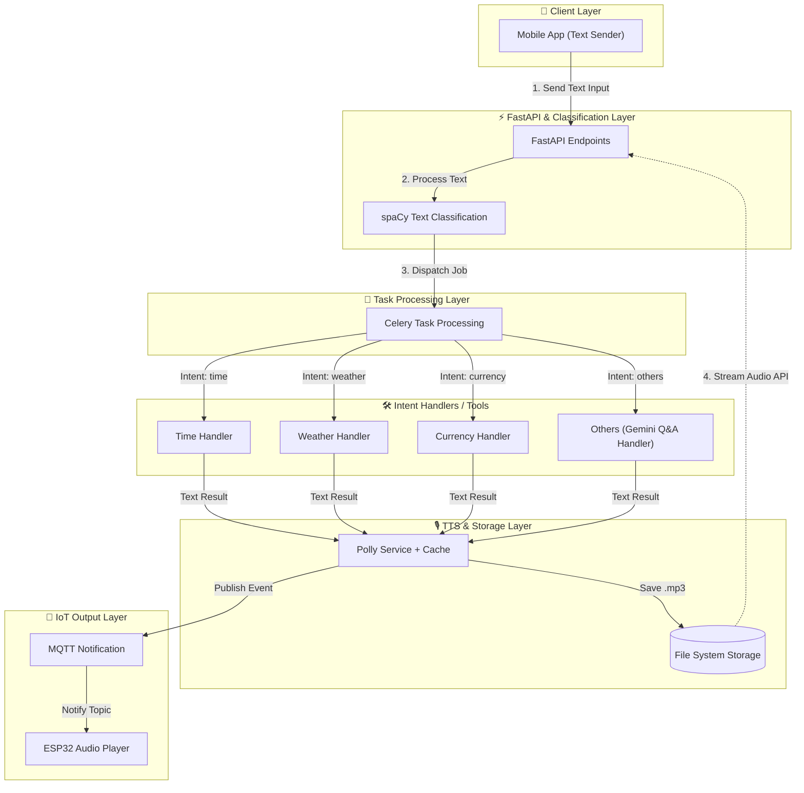

# FastAPI Gemini Tool Router (`fastapi-gemini-tool-router`)

An event-driven, asynchronous Q&A and hardware notification system that routes mobile text input through **spaCy intent classification**, offloads processing to **Celery**, synthesizes audio using **AWS Polly**, and notifies an **ESP32 Audio Player** via **MQTT**.

---

## 📌 System Architecture



---

## 💡 Workflow Overview

1. **Text Ingestion**: Mobile application sends raw text query to the FastAPI `/api/v1/chat` endpoint.
2. **Intent Classification**: The text passes through a **spaCy** classification model to identify the query target: `time`, `weather`, `currency`, or `others`.
3. **Async Queue Handling**: FastAPI hands off the payload to **Celery** backed by **Redis** to ensure non-blocking client execution.
4. **Tool Execution**:
   * `time`: Resolves local/global timezone query.
   * `weather`: Fetches weather conditions from external weather APIs.
   * `currency`: Calculates real-time exchange conversions.
   * `others`: Calls **Google Gemini API** for general-purpose Q&A.
5. **Speech Synthesis & Caching**: Response text is passed to **AWS Polly**. Synthesized audio is stored on the **File System** and cached to prevent redundant AWS calls.
6. **Hardware Notification & Stream**: An **MQTT** message containing the audio ID is broadcast to the **ESP32 Audio Player**. The ESP32 calls the FastAPI streaming endpoint (`/api/v1/audio/{file_id}`) to play back the response audio.

---

## 🛠 Tech Stack

* **API & Web Framework**: [FastAPI](https://fastapi.tiangolo.com/)
* **NLP & Intent Classification**: [spaCy](https://spacy.io/)
* **Task Queue & Cache**: [Celery](https://docs.celeryq.dev/) with [Redis](https://redis.io/)
* **LLM Integration**: [Google Gemini API](https://ai.google.dev/)
* **Text-to-Speech (TTS)**: [AWS Polly](https://aws.amazon.com/polly/)
* **Hardware Messaging**: [MQTT Broker (Eclipse Mosquitto)](https://mosquitto.org/)
* **Hardware Target**: ESP32 microcontrollers


---

## 🚀 Environment Configuration

Create a `.env` file in the project root:

```env
# Gemini API Setup
GEMINI_API_KEY=your_gemini_api_key

# Redis / Celery Config
REDIS_URL=redis://localhost:6379/0
CELERY_BROKER_URL=redis://localhost:6379/0
CELERY_RESULT_BACKEND=redis://localhost:6379/1

# AWS Polly Voice Config
AWS_ACCESS_KEY_ID=your_aws_access_key
AWS_SECRET_ACCESS_KEY=your_aws_secret_key
AWS_REGION=us-east-1
POLLY_VOICE_ID=Joanna

# MQTT Broker Settings
MQTT_BROKER_HOST=localhost
MQTT_BROKER_PORT=1883
MQTT_TOPIC_ESP32=esp32/audio/play
```

---

## ⚡ API Endpoint Reference

### 1. Send Text Query
`POST /api/v1/chat`

**Request Payload:**
```json
{
  "client_id": "esp32_device_01",
  "text": "What is the weather in Tokyo?"
}
```

**Response:**
```json
{
  "task_id": "b3e9a1c2-5d6e-4f8a-9b0c-1d2e3f4a5b6c",
  "status": "QUEUED"
}
```

### 2. Stream Audio Endpoint
`GET /api/v1/audio/{file_id}`

Returns standard `audio/mpeg` byte stream for direct ESP32 hardware playback.

---

## 📄 License

This project is licensed under the MIT License.
